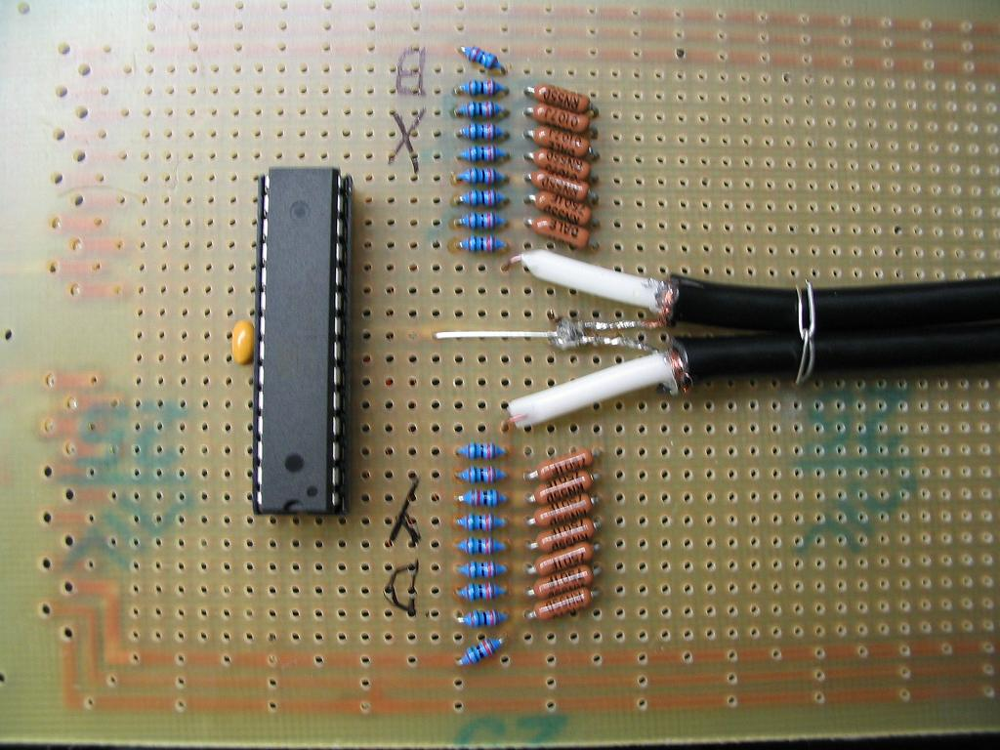

## Files / pictures for building with atmega168

See original site: https://www.evilmadscientist.com/2008/resurrecting-tennis-for-two-a-video-game-from-1958/

Sourcecode TennisCode.zip does NOT contain compiled HEX file for flashing - released as GPL 2

Pictures are from my build in 2013:

